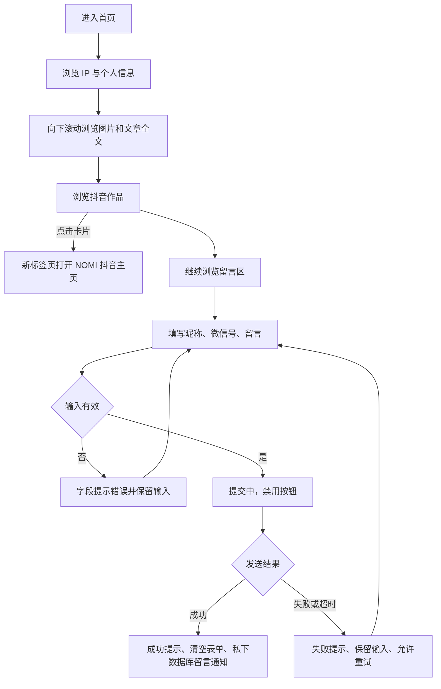
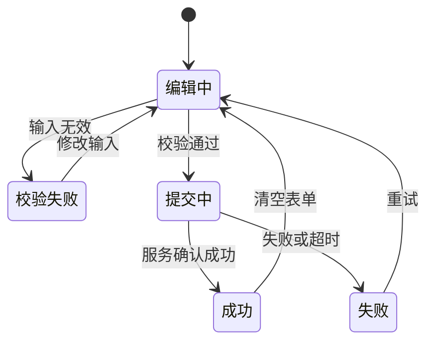
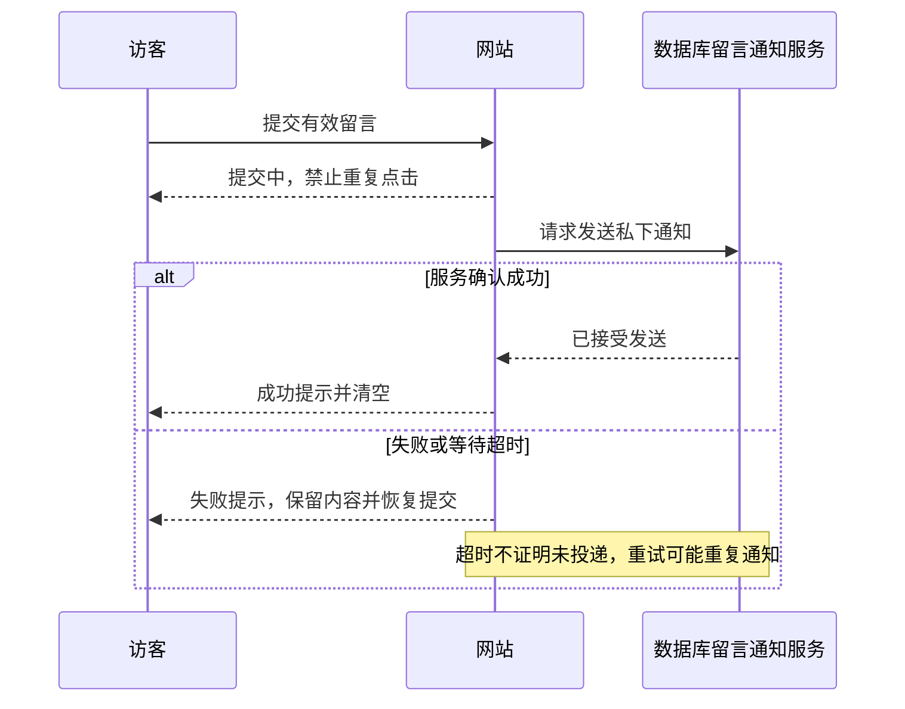

# 产品需求文档：NOMI · Y2K 动漫个人品牌网站 - V1.0

> 状态：需求已确认，待实现与测试。日期：2026-11-11。
> 关联：[测试用例](PRD-001-测试用例.md) · [本轮 SPEC](../specs/SPEC-001-prd-finalization/SPEC.md)

## 1. 综述 (Overview)
### 1.1 项目背景与核心问题

为 NOMI 建立统一的个人品牌展示与联系页面，让访客认识创作者、连续浏览图片和文章、前往抖音主页，并私下提交留言。
本轮是单页网站，不包含文章详情页、图片弹窗、内容管理后台、注册登录、公开留言墙、自动抓取抖音或站内视频播放。视觉沿用 Y2K 动漫方向，具体颜色、字体、动效尚未定稿。

### 1.2 核心业务流程 / 用户旅程地图

1. 认识 NOMI：浏览 IP、昵称与个人信息。
2. 浏览作品：向下滚动直接阅读图片与文章全文。
3. 关注抖音：浏览作品卡片并跳转主页。
4. 留言联系：填写三个必填字段并获得提交结果。

### 1.3 Mermaid 图（流程/状态/时序）
#### 1.3.1 用户操作流



#### 1.3.2 留言提交状态



#### 1.3.3 提交结果与重试



## 2. 用户故事详述 (User Stories)

### 阶段一：认识 NOMI

---

#### **US-001: 作为访客，我希望浏览 IP 与个人信息，以便认识 NOMI**

* **价值陈述 (Value Statement)**：
  * **作为** 访客
  * **我希望** 看到 IP 和个人介绍
  * **以便于** 快速了解创作者
* **业务规则与逻辑 (Business Logic)**：

前置条件：首页可访问，个人资料配置可读取。
正常路径：进入首页，左侧显示 IP，右侧显示个人信息；桌面和手机均左右排列，窄屏缩小 IP，文字自然换行，不裁切、不产生横向滚动。
固定文案：昵称 NOMI；介绍“ISFP，高敏感低精力体质，习惯在观察与思考里梳理自我。”；兴趣“拍照、爵士舞”；内容方向“女性成长、职场焦虑、情绪思考”。
异常：IP 加载失败时原位置显示带 NOMI 文字的占位图，个人信息正常展示。

* **验收标准 (Acceptance Criteria)**：

- **AC-001-01**：GIVEN 已配置个人资料，WHEN 打开首页，THEN 完整展示确认文案和 IP。
- **AC-001-02**：GIVEN 桌面或手机窄屏，WHEN 浏览个人介绍，THEN 左 IP 右信息，文字完整、无横向滚动。
- **AC-001-03**：GIVEN IP 图片加载失败，WHEN 浏览首页，THEN 原位置显示 NOMI 占位图，其余信息正常。

* **页面布局线框图 (ASCII Wireframe)**：

```text
桌面和手机均左右排列，手机缩小图片并换行
┌────────────────────────────────────┐
│ ┌────────┐  NOMI                   │
│ │ IP形象 │  ISFP，高敏感低精力体质，│
│ │        │  习惯在观察与思考里      │
│ └────────┘  梳理自我。              │
│             兴趣｜拍照、爵士舞      │
│             内容｜女性成长          │
│                   职场焦虑          │
│                   情绪思考          │
└────────────────────────────────────┘
```

### 阶段二：浏览个人作品

---

#### **US-002: 作为访客，我希望向下滚动直接浏览图片与文章，以便了解 NOMI 的创作**

* **价值陈述 (Value Statement)**：
  * **作为** 访客
  * **我希望** 连续浏览图片与文章全文
  * **以便于** 无需额外操作了解作品
* **业务规则与逻辑 (Business Logic)**：

前置条件：首页个人介绍之后设作品区。
正常路径：向下滚动，图片与文章在同一单列内容流混合展示，桌面手机一致；顺序由内容配置手动指定，不按日期强制排序。图片按原比例完整展示，文章显示标题和全文，不折叠；无需点击、弹窗或详情页跳转。窄屏内容完整且无横向滚动。
异常：单张图片失败在原位置显示“图片暂时无法加载”，其他内容正常；未配置作品显示“作品整理中，敬请期待”。
边界：本轮不做内容管理后台；图片和文章内容由 NOMI 提供，不能用虚构内容作为正式作品。

* **验收标准 (Acceptance Criteria)**：

- **AC-002-01**：GIVEN 混合配置图片和文章且手动指定顺序，WHEN 向下滚动首页，THEN 按配置顺序单列展示，图片原比例完整、文章标题与全文直接可见。
- **AC-002-02**：GIVEN 手机或桌面视口，WHEN 浏览全部作品，THEN 不要求点击/弹窗/跳转，无裁切或横向滚动。
- **AC-002-03**：GIVEN 单图加载失败，WHEN 滚动浏览，THEN 显示指定失败文案，其余作品正常。
- **AC-002-04**：GIVEN 作品列表为空，WHEN 进入作品区，THEN 显示“作品整理中，敬请期待”。

* **页面布局线框图 (ASCII Wireframe)**：

```text
┌────────────────────────────┐
│          我的作品          │
│ ┌────────────────────────┐ │
│ │ 图片作品，原比例完整显示 │ │
│ └────────────────────────┘ │
│ 文章标题                   │
│ 文章全文直接展开……         │
│ ┌────────────────────────┐ │
│ │ 下一张图片              │ │
│ └────────────────────────┘ │
└────────────────────────────┘
```

### 阶段三：关注抖音

---

#### **US-003: 作为访客，我希望浏览抖音作品并点击卡片，以便前往 NOMI 的主页**

* **价值陈述 (Value Statement)**：
  * **作为** 访客
  * **我希望** 浏览作品封面与标题并进入抖音主页
  * **以便于** 关注创作者
* **业务规则与逻辑 (Business Logic)**：

前置条件：个人作品区之后设抖音作品区。
正常路径：卡片展示封面与标题，内容与顺序手动配置；桌面多列、手机每行两张。点击任意卡片均在新标签页打开同一个已提供主页，不跳转单条视频，不自动抓取抖音数据。
主页 URL：https://www.douyin.com/user/MS4wLjABAAAA7CBclYMzZYaWXAc4nEXGgOgxKrZz8ZyP8JRMrBO0W92dmc6gz2c_M6yRT-xk51Pf?from_tab_name=main
异常：封面失败显示占位图，标题和跳转仍可用；无作品显示“抖音作品整理中，敬请期待”；无主页链接时卡片不可点击并显示“抖音主页即将开放”。
边界：抖音平台登录、客户端唤起和网络可用性由外部平台决定；本站不得把无效配置伪装成可用入口。

* **验收标准 (Acceptance Criteria)**：

- **AC-003-01**：GIVEN 配置多张抖音卡片，WHEN 在桌面/手机查看，THEN 封面和标题可见，手机每行两张，顺序与配置一致。
- **AC-003-02**：GIVEN 有效主页已配置，WHEN 点击任意不同卡片，THEN 新标签页打开同一个指定主页。
- **AC-003-03**：GIVEN 封面失败且主页有效，WHEN 查看和点击卡片，THEN 占位图与标题可见，跳转仍可用。
- **AC-003-04**：GIVEN 无作品，WHEN 查看区域，THEN 显示“抖音作品整理中，敬请期待”。
- **AC-003-05**：GIVEN 有作品但无主页链接，WHEN 尝试点击，THEN 不可跳转，显示“抖音主页即将开放”。

* **页面布局线框图 (ASCII Wireframe)**：

```text
位于个人作品区之后；桌面可更多列，手机每行两张
┌─────────────────────────────┐
│         我的抖音作品        │
│ ┌───────────┐ ┌───────────┐ │
│ │  作品封面 │ │  作品封面 │ │
│ └───────────┘ └───────────┘ │
│ 作品标题       作品标题     │
│ 点击任意作品，去抖音主页    │
└─────────────────────────────┘
```

### 阶段四：留言联系

---

#### **US-004: 作为访客，我希望提交留言，以便私下联系 NOMI**

* **价值陈述 (Value Statement)**：
  * **作为** 访客
  * **我希望** 填写昵称、微信号和留言并获得明确结果
  * **以便于** 让 NOMI 收到联系信息和反馈
* **业务规则与逻辑 (Business Logic)**：

前置条件：抖音区之后展示留言表单，数据库留言通知服务完成私有配置。
字段：昵称、联系方式（微信号）、留言内容全部必填，长度分别为 1–30、1–50、1–2000；纯空格无效，不校验微信号是否真实存在。不收集访客邮箱。
正常路径：桌面和手机单列布局，留言显示字数统计；有效提交进入“提交中…”，禁用按钮防重复点击。邮件内容包含昵称、微信号、留言和提交时间。成功提示“留言已发送，谢谢你的分享”，清空表单。
异常：字段校验失败，在对应字段下显示具体原因并保留全部输入；失败或超时显示“发送失败，请稍后重试”，保留输入并恢复按钮。
隐私：留言不公开展示，仅私下数据库留言通知；留言数据保存至受保护的 Supabase 数据库，由登录后台查看。
依赖：邮件提供商与投递方案尚未选定。成功反馈须基于服务真实成功结果；不能仅本地校验通过就假报发送成功。真实到件单独验收。超时后重试可能造成重复投递，不能承诺端到端仅投递一次。

* **验收标准 (Acceptance Criteria)**：

- **AC-004-01**：GIVEN 表单为空，WHEN 查看表单，THEN 显示昵称、联系方式（微信号）、留言内容三项必填及留言字数统计。
- **AC-004-02**：GIVEN 任一字段为空、纯空格或超过各自上限，WHEN 提交，THEN 阻止发送，在对应字段提示具体错误，保留全部输入。
- **AC-004-03**：GIVEN 字段有效且服务处理中，WHEN 连续点击提交，THEN 按钮显示“提交中…”且禁用，不重复发起提交。
- **AC-004-04**：GIVEN 服务返回真实成功，WHEN 完成提交，THEN 显示成功文案并清空表单，邮件包含四项信息。
- **AC-004-05**：GIVEN 发送失败或超时，WHEN 等待结果，THEN 显示失败文案、保留全部输入、恢复按钮允许重试。
- **AC-004-06**：GIVEN 完成发布构建，WHEN 检查页面、客户端资源和浏览器响应，THEN 不包含留言数据保存至受保护的 Supabase 数据库，由登录后台查看。
- **AC-004-07**：GIVEN 三字段分别处于有效边界且微信号格式并非真实账号，WHEN 校验并提交，THEN 不以账号真实性拒绝，边界内可提交。

* **页面布局线框图 (ASCII Wireframe)**：

```text
┌──────────────────────────────┐
│          给我留言            │
│ 昵称 *                       │
│ [                          ] │
│ 联系方式（微信号）*          │
│ [                          ] │
│ 留言内容 *                   │
│ [                          ] │
│ [                          ] │
│                    0 / 2000  │
│          [ 提交留言 ]        │
└──────────────────────────────┘
错误提示位于对应字段下方。
```

## 3. 实施前依赖与待明确项

已确认需求不等于已实现。正式 IP、图片、文章、抖音封面与标题素材待提供；邮件服务、超时阈值、字符计数方式（尤其 emoji）、空白处理细节与最终视觉方案由后续实现 SPEC 明确。资料缺失时使用已确认空态，不能伪造作品。邮件成功回执与真实到件分别验证。技术栈和上线地址未确定。
